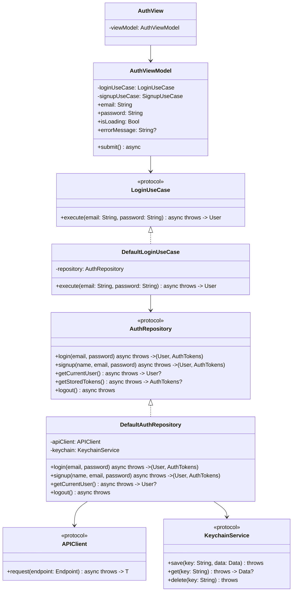
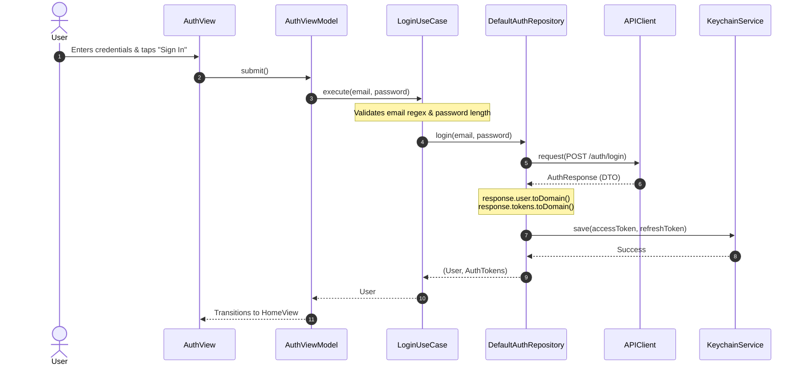

# 📱 AuthApp — iOS Low-Level Design (LLD) Guide

A production-grade, Clean Architecture Low-Level Design (LLD) implementation of an **Authentication System in Swift & SwiftUI**.

Designed specifically for **iOS LLD & System Design Interviews**, keeping each component simple, decoupled, and easy to explain on a whiteboard.

---

## 📑 Table of Contents
1. [Problem Statement & Scope](#1-problem-statement--scope)
2. [Folder & Package Structure](#2-folder--package-structure)
3. [Architecture Overview (Clean Architecture)](#3-architecture-overview)
4. [Mermaid Class & Protocol Diagram](#4-mermaid-class--protocol-diagram)
5. [Step-by-Step Data Flow (Login Trace)](#5-step-by-step-data-flow)
6. [SOLID Principles in Action](#6-solid-principles-in-action)
7. [Design Patterns Applied](#7-design-patterns-applied)
8. [Top 10 iOS LLD Interview Questions & Answers](#8-top-10-ios-lld-interview-questions--answers)
9. [How to Run & Test](#9-how-to-run--test)

---

## 1. Problem Statement & Scope

### Functional Requirements
- **User Authentication**: Support email/password login and new user registration.
- **Session Persistence**: Persist JWT access token and refresh token securely.
- **Auto-Login / Session Restore**: Check if a valid session exists upon app launch.
- **Logout**: Invalidate session and wipe stored tokens.
- **State Feedback**: Provide loading indicators, inline input validation, and user-friendly error messages.

### Non-Functional Requirements
- **Security**: Sensitive tokens must be saved in **Keychain** (encrypted hardware Secure Enclave), never in `UserDefaults`.
- **Testability**: 100% decoupling via protocols (`APIClient`, `KeychainService`, `AuthRepository`, `UseCases`) allowing mock injection.
- **Maintainability**: Strict separation between UI, Business Logic, and Network Serialization.

---

## 2. Folder & Package Structure

```
AuthApp/
│
├── App/
│   └── AuthApp.swift                    # App Entry Point & Root Navigation Router
│
├── Core/
│   ├── Network/
│   │   ├── APIClient.swift              # Endpoint protocol, NetworkError enum & APIClient protocol
│   │   └── URLSessionAPIClient.swift    # Concrete async/await URLSession client + Mock Simulator
│   │
│   ├── Storage/
│   │   └── KeychainService.swift        # Apple Security Framework Keychain Wrapper
│   │
│   └── DI/
│       └── AppContainer.swift           # Dependency Injection & Service Factory (Composition Root)
│
├── Domain/
│   ├── Models/
│   │   ├── User.swift                   # Pure Domain User Entity
│   │   └── AuthTokens.swift             # Access & Refresh Tokens Entity
│   │
│   ├── Repositories/
│   │   └── AuthRepository.swift         # Abstract Protocol defining Auth data contract
│   │
│   └── UseCases/
│       ├── LoginUseCase.swift           # Input validation & Login business logic
│       ├── SignupUseCase.swift          # Input validation & Signup business logic
│       ├── GetCurrentUserUseCase.swift  # Active session check logic
│       └── LogoutUseCase.swift          # Session termination & cleanup logic
│
├── Data/
│   ├── DTO/
│   │   ├── LoginRequest.swift           # Codable POST /auth/login request payload
│   │   ├── SignupRequest.swift          # Codable POST /auth/signup request payload
│   │   └── AuthResponse.swift           # UserDTO, TokensDTO + Domain Mappers
│   │
│   └── Repositories/
│       └── DefaultAuthRepository.swift  # Coordinates APIClient + Keychain storage
│
└── Presentation/
    ├── Auth/
    │   ├── AuthView.swift               # SwiftUI Form (Sign In / Sign Up toggles)
    │   └── AuthViewModel.swift          # @MainActor State & input handler
    │
    └── Home/
        ├── HomeView.swift               # Dashboard with Keychain Token Inspector
        └── HomeViewModel.swift          # Profile state & Logout handler
```

---

## 3. Architecture Overview

This project implements **Clean Architecture** (Robert C. Martin / Uncle Bob) combined with **MVVM**:

```
 ┌──────────────────────────────────────────────────────────────┐
 │                     PRESENTATION LAYER                       │
 │      AuthView / HomeView (SwiftUI)                           │
 │                 │                                            │
 │                 ▼                                            │
 │      AuthViewModel / HomeViewModel (@MainActor)              │
 └─────────────────┬────────────────────────────────────────────┘
                   │ Calls UseCases
                   ▼
 ┌──────────────────────────────────────────────────────────────┐
 │                        DOMAIN LAYER                          │
 │  UseCases: LoginUseCase, SignupUseCase, LogoutUseCase        │
 │  Entities: User, AuthTokens                                  │
 │  Contracts: AuthRepository (Protocol)                        │
 └─────────────────▲────────────────────────────────────────────┘
                   │ Implements Protocol
 ┌─────────────────┴────────────────────────────────────────────┐
 │                         DATA LAYER                           │
 │  DefaultAuthRepository                                       │
 │  DTOs: LoginRequest, SignupRequest, AuthResponse + Mappers   │
 └─────────────────┬────────────────────────────────────────────┘
                   │ Uses Core Services
                   ▼
 ┌──────────────────────────────────────────────────────────────┐
 │                         CORE LAYER                           │
 │  APIClient (URLSessionAPIClient)                             │
 │  KeychainService (DefaultKeychainService)                    │
 │  AppContainer (Dependency Injection Root)                    │
 └──────────────────────────────────────────────────────────────┘
```

> **Dependency Rule**: Dependencies point **inward** toward the Domain Layer. The Domain layer has **zero dependencies** on UIKit, SwiftUI, URLSession, or Security framework.

---

## 4. Mermaid Class & Protocol Diagram



---

## 5. Step-by-Step Data Flow

### The Login Trace:
1. **User Action**: User enters `alex.dev@example.com` and `password123` on `AuthView` and taps **"Sign In"**.
2. **Presentation**: `AuthView` calls `await viewModel.submit()`.
3. **State Update**: `AuthViewModel` sets `isLoading = true` on the `@MainActor`.
4. **Domain Execution**: `AuthViewModel` calls `loginUseCase.execute(email, password)`.
5. **Business Validation**: `DefaultLoginUseCase` validates:
   - Non-empty email & password
   - Valid email regex pattern
   - Password minimum length (>= 6 characters)
6. **Data Coordination**: `DefaultLoginUseCase` calls `repository.login(email, password)`.
7. **Network Request**: `DefaultAuthRepository` encodes `LoginRequest` into JSON and invokes `apiClient.request(endpoint)`.
8. **DTO Mapping**: Server returns `AuthResponse` (`UserDTO` + `TokensDTO`). The DTO's `toDomain()` method converts it into pure domain models `User` and `AuthTokens`.
9. **Secure Storage**: `DefaultAuthRepository` securely writes `accessToken` and `refreshToken` into Apple Keychain via `keychain.save()`.
10. **State Propagation**: `AuthViewModel` receives the authenticated `User`, clears errors, and triggers root navigation to `HomeView`.



---

## 6. SOLID Principles in Action

| Principle | How It's Applied in this Project |
| :--- | :--- |
| **S - Single Responsibility** | `LoginUseCase` only validates and executes login. `KeychainService` only manages keychain operations. `AuthViewModel` only manages UI state. |
| **O - Open/Closed** | New API endpoints conform to `Endpoint` protocol without changing `APIClient`. New auth strategies (e.g. Apple Sign-In) can be added as new UseCases. |
| **L - Liskov Substitution** | `URLSessionAPIClient` can be substituted with a mock network client or GraphQL client conforming to `APIClient` without breaking any repository code. |
| **I - Interface Segregation** | Fine-grained protocols: `LoginUseCase`, `SignupUseCase`, `LogoutUseCase` rather than one monolithic 500-line `AuthManager`. |
| **D - Dependency Inversion** | High-level `LoginUseCase` depends on abstract `AuthRepository` protocol, NOT on concrete `DefaultAuthRepository` or `URLSession`. |

---

## 7. Design Patterns Applied

1. **Repository Pattern (`AuthRepository`)**:
   - Abstracts the origin of data (network vs keychain cache) away from the business layer.
2. **Use Case / Interactor Pattern (`LoginUseCase`, etc.)**:
   - Enforces the Single Responsibility Principle and encapsulates reusable business rules.
3. **Dependency Injection / Composition Root (`AppContainer`)**:
   - Centralizes object graph creation, making mocking trivial for unit tests and SwiftUI previews.
4. **Adapter Pattern (`URLSessionAPIClient`)**:
   - Adapts Apple's `URLSession` data task methods to the custom `APIClient` protocol.
5. **Data Transfer Object (DTO) & Mapper Pattern (`AuthResponse` -> `toDomain()`)**:
   - Prevents breaking API schema changes (like `snake_case` keys) from leaking into Domain models.

---

## 8. Top 10 iOS LLD Interview Questions & Answers

### Q1: Why separate DTOs from Domain Models?
> **Answer**:
> - **Decoupling**: Backend API keys (`user_id`, `created_at`) can change without touching UI or business logic.
> - **Type Safety**: Backend may return Unix timestamps (`Double`), while Domain needs `Date`.
> - **Domain Enrichment**: Domain entities can hold business helper methods (e.g., `tokens.isExpired`), while DTOs remain dumb serialization structures.

---

### Q2: Why use Keychain instead of UserDefaults for tokens?
> **Answer**:
> - `UserDefaults` stores data in an unencrypted `.plist` file located in the app's sandbox. Anyone with physical or jailbroken access (or unencrypted iTunes backup) can extract raw JWT tokens.
> - `Keychain` is encrypted at rest using keys rooted in the device's **Secure Enclave** hardware chip and is protected by iOS data protection classes.

---

### Q3: Where should Token Refresh logic live in Clean Architecture?
> **Answer**:
> - **Inside the Network / Repository layer**: Usually handled via an `AuthInterceptor` or inside `DefaultAuthRepository`.
> - When `APIClient` receives an HTTP `401 Unauthorized`, an interceptor intercepts the failure, executes a refresh token request, updates the Keychain, and replays the original failed request seamlessly without the ViewModel knowing.

---

### Q4: How do you prevent Race Conditions during concurrent token refreshes?
> **Answer**:
> - Use a Swift **`actor`** or a `Task` queue with an active refresh task check:
>   ```swift
>   actor TokenRefreshManager {
>       private var refreshTask: Task<String, Error>?
>       
>       func validAccessToken() async throws -> String {
>           if let ongoing = refreshTask { return try await ongoing.value }
>           // Start refresh task once and reuse across concurrent callers
>       }
>   }
>   ```

---

### Q5: Why use UseCases instead of calling the Repository directly from ViewModel?
> **Answer**:
> - **Reusability**: If both `AuthView` and a `QuickLoginWidget` need login, the logic (validation + logging + analytics) lives in one `LoginUseCase`.
> - **Granular Testing**: We can test `LoginUseCase` with unit tests without creating ViewModels or mocking full repositories.

---

### Q6: How do you unit test `AuthViewModel`?
> **Answer**:
> - Inject a `MockLoginUseCase` conforming to `LoginUseCase`.
> - Set mock expectations (return user or throw `AuthError.invalidEmail`).
> - Assert `viewModel.errorMessage` or `viewModel.currentUser` matches expectations without touching the network.

---

### Q7: Why is `@MainActor` applied to `AuthViewModel`?
> **Answer**:
> - SwiftUI views observe `@Published` properties. Changing `@Published` properties on a background thread causes runtime warnings and UI glitches.
> - Marking the ViewModel `@MainActor` ensures all property mutations and UI callbacks run on the main thread.

---

### Q8: What is the difference between Service Locator and Dependency Injection?
> **Answer**:
> - **Service Locator**: Classes reach out and ask a central registry for dependencies (`ServiceLocator.shared.get()`), hiding real dependencies and complicating testing.
> - **Dependency Injection (Constructor Injection)**: Dependencies are explicitly passed through `init(repository: AuthRepository)`, making contracts clear and mocks easily swappable. `AppContainer` acts as the DI factory.

---

### Q9: How do you support offline demo mode during an interview?
> **Answer**:
> - In `URLSessionAPIClient`, add a boolean flag `isMockMode`. When `true`, it simulates 0.6s latency using `Task.sleep` and decodes realistic mock JSON responses. This allows running and demonstrating the app immediately on simulator without a backend server!

---

### Q10: How do you extend this architecture for Biometric Authentication (FaceID / TouchID)?
> **Answer**:
> - Create a `BiometricService` protocol in `Core/Storage/`.
> - Use Apple's `LocalAuthentication` (`LAContext`) to authenticate.
> - Store the refresh token in Keychain with `.userPresence` access control flag so Keychain itself unlocks only after biometric verification.

---

## 9. How to Run & Test

1. Open the project in **Xcode 16+**:
   ```bash
   open "Authentication app/Authentication app.xcodeproj"
   ```
2. Select any **iOS Simulator** (e.g. iPhone 16 Pro) and hit **Cmd + R**.
3. **Demo Features**:
   - Tap **"Fill Demo Credentials"** for instant testing.
   - Tap **"Sign In"** or toggle to **"Sign Up"**.
   - Notice input validation for invalid email formats or short passwords.
   - After signing in, explore the **Dashboard**: view profile, examine masked tokens in **Keychain**, and test **"Log Out"**.
